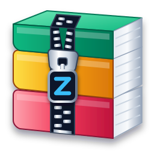

<div align="center">



# `libzar` — ZeroArchive Public SDK

**High-Compression, Solid-Stream, Cryptographically Verified `.zar` Archive Engine**

[](#)
[](#api-reference)
[](#platform-distribution-matrix)
[](LICENSE)

[Overview](#overview) · [Quick Start](#quick-start) · [Benchmarks](#verified-performance-highlights) · [API Reference](#api-reference) · [Security](#security-integrity--thread-safety)

</div>

---

## Overview

**`libzar`** is the official cross-platform C-ABI Shared Library SDK for creating, inspecting, verifying, and extracting **`.zar` (ZeroArchive)** files.

Built for high compression ratios, zero-decompression metadata inspection, and end-to-end cryptographic integrity, `libzar` exposes a minimal, memory-safe **C99** interface that integrates cleanly into **C / C++**, **Python (`ctypes`)**, **Node.js (`koffi`)**, **Go (`cgo`)**, **C# (P/Invoke)**, and **Rust** applications.

### Key Capabilities

| Capability | Description |
| :--- | :--- |
| **Dual Compression Engines** | **LZMA2** (configurable `16 MB – 1024 MB` dictionary) for maximum density, and multi-threaded **Zstd** for high-speed throughput. |
| **Solid Block Architecture** | Concatenates files into continuous solid streams (with configurable block-size boundaries) to maximize cross-file redundancy elimination. |
| **Zero-Decompression Listing** | Reads the Central Directory footer directly to list files, sizes, timestamps, and hashes in milliseconds without decompressing the payload. |
| **Selective Single-File Extraction** | Extract an individual file by relative path (`zar_extract_file`) by decompressing only its containing block. |
| **Authenticated Encryption** | Optional **AES-256-GCM** encryption for both the Central Directory (header) and data payload with **Argon2id** key derivation. |
| **BLAKE3 Integrity & Safe Paths** | Verifies every extracted file against its **BLAKE3** digest and rejects directory-traversal (`..`, rooted, or prefixed) paths. |
| **Progress & Cancellation** | Thread-local progress callback (`zar_set_progress_callback`) with instant cancellation support (`ZAR_ERR_CANCELLED`). |

---

## Verified Performance Highlights

Measured on a `1,051.20 MiB` (`987` files) mixed-binary application directory:

| Profile | Compressed Size | Compression Time | Throughput | Integrity Verify (`zar_verify`) |
| :--- | :---: | :---: | :---: | :---: |
| **Zstd** (Level `3`, `64 MB` parallel blocks) | `914.14 MiB` | **`8.55 s`** | **`122.95 MiB/s`** | **`0.27 s`** (`~3.8 GiB/s`) |
| **LZMA2** (Level `3`, `32 MB` dict, `64 MB` parallel blocks) | **`869.77 MiB`** | `58.89 s` | `17.85 MiB/s` | **`1.84 s`** (`571 MiB/s`) |

---

## SDK Package Layout

```text
zar-sdk/
├── assets/
│   ├── zar_logo.svg         # Vector ZeroArchive brand emblem
│   ├── zar_logo.png         # 512x512 transparent PNG emblem
│   └── zar_logo.ico         # Multi-size Windows icon
├── include/
│   └── zar.h                # Public C99 / C++ compatible header
├── lib/
│   └── libzar.dll           # Stripped native shared library (or libzar.so / libzar.dylib)
├── examples/
│   ├── python_test.py       # Zero-dependency Python ctypes integration example
│   └── node_test.js         # Node.js koffi FFI integration example
├── LICENSE                  # SDK binary redistribution license
└── README.md                # Documentation
```

---

## Quick Start

### C / C++

```c
#include <stdio.h>
#include "zar.h"

int main(void) {
    ZarOptions opts = {
        .algorithm           = ZAR_ALGO_ZSTD,
        .level               = 6,
        .dict_size_mb        = 16,
        .solid_mode          = 1,
        .encrypt_header      = 1,
        .encrypt_payload     = 1,
        ._reserved           = 0,
        .solid_block_size_mb = 64,
        .password            = "my-strong-password"
    };

    if (zar_compress("./my_folder", "./archive.zar", opts) != ZAR_OK) {
        fprintf(stderr, "Compress error: %s\n", zar_last_error());
        return 1;
    }

    const char* json = zar_list_contents("./archive.zar", "my-strong-password");
    if (json != NULL) {
        printf("Archive Contents:\n%s\n", json);
        zar_free_string(json);
    }

    if (zar_verify("./archive.zar", "my-strong-password") != ZAR_OK) {
        fprintf(stderr, "Integrity check failed: %s\n", zar_last_error());
        return 1;
    }

    if (zar_extract("./archive.zar", "./restored", "my-strong-password") != ZAR_OK) {
        fprintf(stderr, "Extract error: %s\n", zar_last_error());
        return 1;
    }

    return 0;
}
```

**Compile & Link (Linux / macOS):**
```bash
cc main.c -I./include -L./lib -lzar -Wl,-rpath,'$ORIGIN/lib' -o zar_app
```

### Python (`ctypes`)

Zero external dependencies — runs directly with the Python standard library:

```bash
python examples/python_test.py
```

### Node.js (`koffi`)

```bash
npm install koffi
node examples/node_test.js
```

---

## API Reference

### `ZarOptions` Struct

Defined in [`include/zar.h`](include/zar.h):

```c
typedef struct ZarOptions {
    int32_t     algorithm;            /* ZAR_ALGO_LZMA2 (1) or ZAR_ALGO_ZSTD (2) */
    int32_t     level;                /* Compression level: 1..9 (0 = default 6) */
    uint32_t    dict_size_mb;         /* Dictionary size in MB: 16..1024 (0 = default 16) */
    uint8_t     solid_mode;           /* 1 = enable solid compression, 0 = per-file */
    uint8_t     encrypt_header;       /* 1 = encrypt central directory, 0 = plaintext */
    uint8_t     encrypt_payload;      /* 1 = encrypt data blocks, 0 = plaintext */
    uint8_t     _reserved;            /* Must be 0 */
    uint64_t    solid_block_size_mb;  /* Max MB per solid block (0 = single continuous block) */
    const char* password;             /* UTF-8 password (NULL if encryption disabled) */
} ZarOptions;
```

| Field | Type | Valid Values & Behavior |
| :--- | :--- | :--- |
| `algorithm` | `int32_t` | `ZAR_ALGO_LZMA2` (`1`) for maximum compression ratio; `ZAR_ALGO_ZSTD` (`2`) for high-speed multi-threaded compression. |
| `level` | `int32_t` | `1` (fastest) to `9` (maximum compression). Pass `0` to use the default (`6`). |
| `dict_size_mb` | `uint32_t` | Dictionary size in MiB (`16` to `1024`). Pass `0` to use the default (`16`). Primarily tunes LZMA2 memory/ratio trade-offs. |
| `solid_mode` | `uint8_t` | `1` to group files into solid blocks; `0` to compress each file independently. |
| `encrypt_header` | `uint8_t` | `1` to encrypt the Central Directory (hides file names, sizes, and hashes without password). |
| `encrypt_payload` | `uint8_t` | `1` to encrypt compressed data blocks with AES-256-GCM. |
| `_reserved` | `uint8_t` | Reserved for ABI alignment. Always initialize to `0`. |
| `solid_block_size_mb` | `uint64_t` | Maximum uncompressed size (in MiB) per solid block when `solid_mode = 1`. Pass `0` for a single continuous solid stream. |
| `password` | `const char*` | Null-terminated UTF-8 password. Required (non-NULL, non-empty) if `encrypt_header` or `encrypt_payload` is `1`. |

---

### Exported Functions

#### `zar_compress`
```c
int zar_compress(const char* input_path, const char* output_zar_path, ZarOptions options);
```
Compresses a file or directory tree recursively into `output_zar_path`. Returns `ZAR_OK` (`0`) or a negative `ZAR_ERR_*` code.

#### `zar_extract`
```c
int zar_extract(const char* input_zar_path, const char* output_dir, const char* password);
```
Extracts all files and empty directories into `output_dir`, restores modification timestamps, and verifies every file's **BLAKE3** checksum.

#### `zar_extract_file`
```c
int zar_extract_file(
    const char* input_zar_path,
    const char* entry_path,
    const char* output_dir,
    const char* password
);
```
Extracts a single file by relative archive path (decompressing only its containing block) and verifies its **BLAKE3** checksum.

#### `zar_verify`
```c
int zar_verify(const char* input_zar_path, const char* password);
```
Verifies archive integrity (decryption tags + BLAKE3 checksums) in-memory without writing extracted files to disk.

#### `zar_list_contents`
```c
const char* zar_list_contents(const char* input_zar_path, const char* password);
```
Inspects the archive header and Central Directory without decompressing the payload.
- Pass `NULL` for `password` if `encrypt_header` was not enabled (even if `encrypt_payload` is enabled).
- **Memory Ownership:** You **must** free every non-NULL pointer returned by this function using `zar_free_string()`. Do **not** pass it to `free()`.

#### `zar_free_string`
```c
void zar_free_string(const char* ptr);
```
Releases the string buffer allocated by `zar_list_contents`. Safe to call with `NULL`.

#### `zar_last_error`
```c
const char* zar_last_error(void);
```
Returns a thread-local error description for the last failed `zar_*` call on the current thread, or `NULL` if the last call succeeded. Valid until the next `zar_*` call on the same thread; **do not** pass to `zar_free_string()`.

#### `zar_set_progress_callback`
```c
typedef int (*ZarProgressCallback)(uint64_t processed_bytes, uint64_t total_bytes, void* user_data);
void zar_set_progress_callback(ZarProgressCallback cb, void* user_data);
```
Registers (or clears with `NULL`) a thread-local progress/cancellation callback for the current thread. Returning non-zero aborts the operation with `ZAR_ERR_CANCELLED` (`-8`).

---

### Error Codes

| Code | Constant | Description |
| :---: | :--- | :--- |
| `0` | `ZAR_OK` | Operation completed successfully. |
| `-1` | `ZAR_ERR_INVALID_ARG` | Null pointer, invalid UTF-8 string, or out-of-range option (`level`, `dict_size_mb`, `algorithm`). |
| `-2` | `ZAR_ERR_IO` | Filesystem error (missing input path, permission denied, disk full). |
| `-3` | `ZAR_ERR_FORMAT` | Invalid `.zar` magic bytes, unsupported format version, or corrupt Central Directory. |
| `-4` | `ZAR_ERR_COMPRESSION` | Compression or decompression stream failure (LZMA2 / Zstd). |
| `-5` | `ZAR_ERR_CRYPTO` | Missing password, empty password, wrong password, or AES-256-GCM authentication failure. |
| `-6` | `ZAR_ERR_CHECKSUM` | Extracted file failed BLAKE3 integrity verification. |
| `-7` | `ZAR_ERR_PATH_TRAVERSAL` | Archive entry contained an unsafe path (e.g., `..` or absolute root). |
| `-8` | `ZAR_ERR_CANCELLED` | Operation cancelled by caller via progress callback. |
| `-99` | `ZAR_ERR_INTERNAL` | Unexpected internal error caught safely at the ABI boundary. |

---

## JSON Output Schema (`zar_list_contents`)

```json
{
  "version": 1,
  "algorithm": "zstd",
  "level": 6,
  "dict_size_mb": 16,
  "solid_mode": true,
  "encrypted_header": true,
  "encrypted_payload": true,
  "file_count": 2,
  "empty_dirs": [],
  "files": [
    {
      "path": "hello.txt",
      "original_size": 5800,
      "compressed_offset": 32,
      "block_index": 0,
      "blake3": "b1665215f0cb24c21c41c5b5ad5738acafb7ec8929433ea0db5f1dbe292105f6",
      "modified_time": 1795696601,
      "created_time": 1795696601
    }
  ]
}
```

---

## Security, Integrity & Thread Safety

- **Key Derivation & Cipher:** Uses **Argon2id** password-based key derivation and **AES-256-GCM** authenticated encryption to protect both archive headers and data payloads against unauthorized access and tampering.
- **Memory & ABI Safety:** Derived cryptographic key material is cleared from memory after use, and all C-ABI entrypoints return opaque error codes without unwinding across the ABI boundary.
- **Thread Safety:** All functions in `libzar` are stateless and thread-safe across distinct archive files. Do not concurrently write to and read from the same `.zar` file path.
- **Path Encoding:** All string arguments (`input_path`, `output_zar_path`, `output_dir`, `password`) must be valid **UTF-8** null-terminated strings.

---

## Platform Distribution Matrix

| Operating System | Shared Library | Dynamic Loader Env Var |
| :--- | :--- | :--- |
| **Windows (x64)** | `lib/libzar.dll` | `PATH` (or same directory as executable) |
| **Linux (x64 / arm64)** | `lib/libzar.so` | `LD_LIBRARY_PATH` / `-Wl,-rpath` |
| **macOS (Universal / arm64)** | `lib/libzar.dylib` | `DYLD_LIBRARY_PATH` / `@rpath` |

---

<div align="center">
  <sub>Licensed under the <a href="LICENSE">libzar Public SDK License</a> · © 2026 ZeroArchive</sub>
</div>
